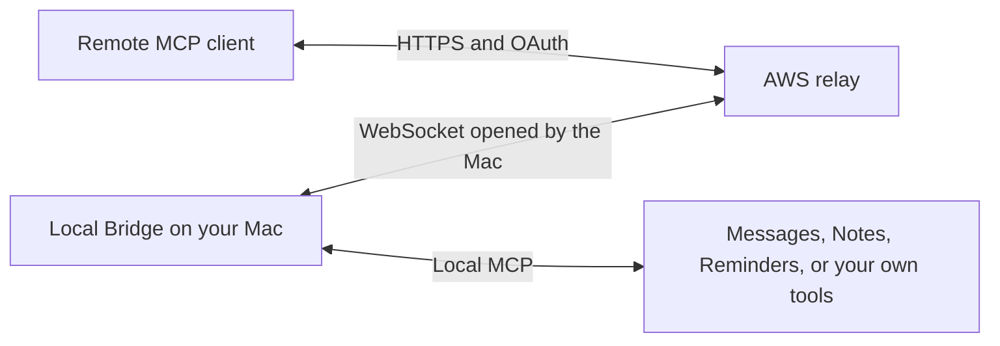

# Local Bridge

Local Bridge lets remote Model Context Protocol (MCP) clients use tools that run on your Mac. From the macOS app, you pick which local servers to share and turn on individual tools. Each server gets a connector URL you can add to an MCP client that supports remote custom connectors.

For example, you could let an assistant search Messages for a detail, give it permission to create or complete a reminder, and let it draft or update a note. You decide which tools are available for each server. Tools that make changes start off.

[Project site](https://bridge.martzmakes.com/) · [Download for Mac](https://bridge.martzmakes.com/updates/LocalBridge-Mac-0.3.1.zip) · [Self-hosting walkthrough](docs/self-hosting.md)

## What runs where

- **On the Mac**, Local Bridge manages the tools you share. It runs a Node.js daemon that starts configured local MCP servers and maintains an outbound WebSocket. You can import server configurations from supported apps or add a command by hand.
- **On AWS**, CloudFront and API Gateway receive HTTPS requests. Lambda checks access and relays approved calls to the Mac. DynamoDB tracks registrations and in-flight calls so a reply can reach the right request. SES sends magic-link email.
- **In your MCP client**, add the URL from the Mac app. The bridge authenticates the client before returning a tool list or forwarding a call. Keep the Mac awake and connected when you want to use its tools.

Calls to an offline Mac fail promptly and expire rather than waiting for it to wake. The Mac does not need an inbound port or VPN. Tool inputs and results pass through the bridge for the call. Audit entries record metadata such as tool name, timing and outcome. [Detailed architecture](https://bridge.martzmakes.com/#how) · [Threat model](docs/threat-model.md)

## Get started

1. Install the [Mac app](https://bridge.martzmakes.com/updates/LocalBridge-Mac-0.3.1.zip). It needs an Apple silicon Mac, macOS 14 or newer, and Node.js 22 or newer.
2. **Hosted:** [sign in with your email](https://bridge.martzmakes.com/account) to start on Free. You can upgrade to Plus from your account. **Self-hosted:** follow the [AWS walkthrough](docs/self-hosting.md), then choose **Choose Backend… → Self-hosted** before signing in. The walkthrough includes AWS console steps, deployment commands, and a demo server.
3. Click **+** in Local Bridge to import a local MCP server or enter its command. Enable the tools you want to share, then click **Save**. Some servers need macOS permissions for the apps or databases they access. [macOS permissions](docs/permissions.md)
4. Copy the server's URL from **Connect**, add it to your remote MCP client, and authenticate. Start with a read tool while the Mac is online.

Local Bridge provides the relay and the macOS controls. Install or supply the local MCP servers for the apps you want to use.

## Connector URLs and access

| Use | Example | What the client sees |
| --- | --- | --- |
| One server | `https://bridge.example.com/mcp/<uuid>` | That server's available tools under their original names, such as `search_notes`. |
| All servers on an account | `https://bridge.example.com/mcp` | Available tools prefixed with their machine and server names, such as `mymac__notes__search_notes`. |

Each connector UUID is an identifier. Access requires valid credentials. A regular OAuth connector sign-in uses the built-in owner identity and can use the tools the Mac exposes. For clients that accept an `Authorization: Bearer` header, create a scoped agent and mint a token. Scoped agents start with no tool access. Each write tool needs an exact allow rule and must be enabled on the Mac. [Managing agents and tokens](docs/operations.md)

## Inside the repository

| Path | What it does |
| --- | --- |
| `macapp/` | SwiftUI app for sign-in, backend selection, per-tool controls, and daemon supervision. |
| `agent/` | Node.js process that runs local MCP servers and connects to AWS. |
| `infra/` | AWS CDK, Lambda handlers, WebSocket protocol, and operator CLI. |
| `app/` | Public website and browser sign-in app. |
| `docs/` | [Self-hosting](docs/self-hosting.md), [operations](docs/operations.md), [cost estimates](docs/hosted-service.md), and [architecture](docs/architecture.md). |

The [original design](docs/superpowers/specs/2026-11-15-local-bridge-design.md) covers the WebSocket relay, data model and failure handling. The [desktop design](docs/superpowers/specs/2026-11-15-mac-app-per-server-endpoints-design.md) explains how the Mac app registers devices and manages per-server connectors.

## Contributing and security

See [Contributing](CONTRIBUTING.md) for building and testing each component, and the [security reporting policy](SECURITY.md) for vulnerability reports.

Local Bridge is licensed under the [MIT License](LICENSE).
