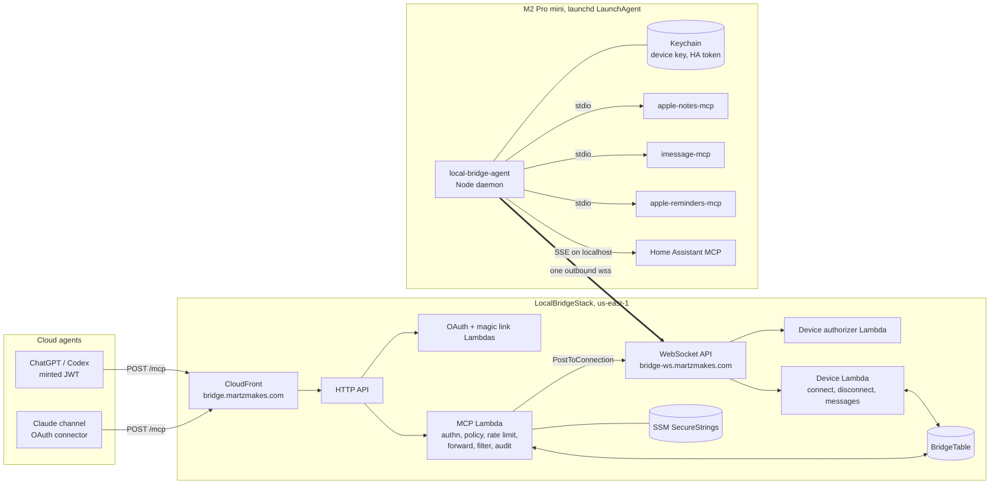

# Local Bridge: design

Date: 2026-11-15. Status: approved for build by the brief (Matt asked for autonomous work); the calls marked **(my call)** were made without him and are the ones to review.

## 1. Intent

Cloud-hosted agents (Claude channels, ChatGPT, Codex) cannot reach MCP servers that only run on Matt's Macs: Apple Messages, Notes, Reminders, Home Assistant on the LAN, and any other local stdio server. Local Bridge is one remote MCP server at `https://bridge.martzmakes.com/mcp` that forwards tool calls to those machines over a connection the machine opens outbound.

The bridge carries the most sensitive data Matt has (texts, notes), and it can act as him (send a text). So the design is security-first: nothing is reachable until it is granted, twice.

### Goals

- One connector URL gives a cloud agent the local tools it has been granted, namespaced by machine and server.
- No inbound ports, no VPN, no Tailscale. The Mac dials out.
- Per-agent, per-tool default-deny allowlist. Write tools off unless enabled per agent.
- A call to a sleeping or disconnected machine fails in seconds with a clear message.
- Content-free audit trail with a retention limit.
- First milestone: read-only Apple Notes search, end to end, from a Claude channel.

### Non-goals

- Streaming tool output, MCP resources, prompts, sampling or elicitation pass-through. Tools only.
- Queueing calls for an offline machine. A late "send a text" is worse than a failed one.
- A web admin UI. Admin is a local CLI (`infra/scripts/admin.ts`).
- Multi-tenant use. One owner.

### Anti-goals (a failure even if it works)

- Message or note content in CloudWatch or DynamoDB audit rows.
- A wildcard grant that silently includes a write tool.
- A hang: any path where the agent waits the full HTTP timeout to learn the mini is asleep.
- A stale call executing after the machine wakes.

## 2. Constraints (from the brief and the existing pattern)

- Scaffold: `expo-cdk-stack` with Stripe and the paywall removed. This repo was cut from the Skylight repo at `66871fc`, which is that template already stripped, plus the fixes Skylight found (`/oauth/consent` route, refresh-token grace window).
- AWS CDK in TypeScript, one stack `LocalBridgeStack`, us-east-1, account 123456789012, deployed locally with `your-profile`. No GitHub Actions.
- Streamable HTTP at `/mcp`. Connector sign-in by magic link to operator@example.com through the template's OAuth 2.1 + PKCE flow.
- Machine access for agents through JWTs minted by `infra/scripts/mint.ts`, scoped per agent.
- Secrets in SSM SecureStrings, state in DynamoDB, TypeScript strict, Zod, `@modelcontextprotocol/sdk`.

## 3. Approaches

### 3.1 Transport for cloud-to-machine calls

| | API Gateway WebSocket | IoT Core MQTT | SQS long-poll |
|---|---|---|---|
| Added latency per call (cloud side) | ~60-150 ms (PostToConnection, one Lambda on the way back, result poll) | ~60-150 ms (Publish, IoT rule to Lambda on the way back, same poll) | ~50-300 ms; long-poll delivery is usually fast but has a long tail |
| Cost with one machine and almost no traffic | ~$0.01/mo connection-minutes, ~$0.08/mo for 60 s heartbeats | ~$0.004/mo connection-minutes; MQTT keep-alives are free | 3 receives/min is ~130k requests/mo, inside the free tier |
| Presence | `$connect` / `$disconnect` plus heartbeat | Lifecycle events and last-will; best of the three | None; heartbeat only |
| Reconnect | Client reconnects. Hard limits: 10 min idle, 2 h max connection | Client reconnects; persistent sessions resume | Stateless; nothing to reconnect |
| Calls made while the machine is offline | Fail immediately (410 Gone or no ack) | QoS 1 with a persistent session queues them | Queued until retention expires |
| Device credential | Anything a Lambda authorizer can check; here an Ed25519 key | X.509 client certificate | Long-lived IAM access key on the Mac, or IAM Roles Anywhere |
| Payload | 128 KB message, 32 KB frame | 128 KB | 256 KB |
| Fit with the template | Already the documented extension path (HttpApi, DynamoDB, Lambdas) | New service: things, policies, certificates, topic rules | Simple, but an IAM principal lives on the Mac |

**Picked: API Gateway WebSocket.** Latency is equal to IoT and better than SQS in the tail. Cost is a rounding error for all three. The deciding points:

1. No store-and-forward. SQS and MQTT persistent sessions deliver old calls when the machine wakes, which is the anti-goal. With WebSocket a call reaches a live machine or fails. (Both alternatives can be made safe with deadlines, and the bridge sets deadlines anyway, but here safety is the default instead of something to remember.)
2. The device credential stays a keypair the bridge owns end to end. SQS needs AWS credentials on the Mac. IoT needs certificate provisioning that CDK does not do cleanly in one stack.
3. It is the template's own extension path, so the stack stays one familiar shape.

What WebSocket costs: the two hard limits. The local agent sends a heartbeat every 60 s (idle limit) and reconnects on its own at 110 minutes (2 h limit), and after any drop with jittered exponential backoff from 1 s to 60 s. During a reconnect, calls fail fast with "reconnecting, retry in a few seconds".

IoT Core is the fallback if the WebSocket limits ever bite. The wire protocol (section 6) does not depend on the transport.

### 3.2 How the cloud waits for a result

The Lambda that serves `/mcp` and the Lambda that receives the machine's reply are different invocations, so they need a rendezvous.

- **DynamoDB poll (picked).** The MCP Lambda writes a `CALL` row, pushes the call, then reads the row with strongly consistent `GetItem` every 40 ms for the first 2 s and every 120 ms after. A 1 s call costs about 30 read units, around $0.000004.
- Machine POSTs the result to an HTTPS endpoint: still a second invocation, same rendezvous problem.
- A long-lived container holding both connections: removes the poll, adds a server to run. Not worth it at this traffic.

### 3.3 Where policy is enforced

- **Cloud only**: one place to manage, but a cloud compromise reaches everything on the Mac.
- **Machine only**: safest, but grants cannot be changed away from the Mac and audit is scattered.
- **Both (picked)**: the cloud holds the per-agent allowlist, filters, limits and audit. The machine's config file is a second, independent allowlist of which servers and tools exist at all and which write tools may ever run. A tool has to be allowed in both places. Compromising AWS cannot make the mini send a text that the config on the mini does not expose.

## 4. Architecture



Life of a call:

1. Agent sends `tools/call` for `mini__notes__search_notes` with a bearer token.
2. MCP Lambda verifies the JWT, resolves the agent, checks the agent is enabled and the token version is current.
3. Rate limit, payload limit, allowlist rule, argument policy. Any failure is audited and returned as a tool error.
4. Machine liveness check from `MACHINE` row. Stale heartbeat: fail now.
5. Write `CALL` row (pending, 5 min TTL). `PostToConnection` with the call and its deadline. `GoneException`: fail now.
6. Machine acks on receipt, runs the tool against the local server, sends the result (chunked if large).
7. Device Lambda checks the result came from the machine the call was sent to, stores it, marks the row done.
8. MCP Lambda sees done, applies the agent's result filter and size limit, writes the audit row, responds.

No ack within 3 s: "mini is not responding (probably asleep)". No result by the deadline: "timed out after N s" and a `cancel` is sent to the machine.

## 5. Identity and auth

### 5.1 Agents

An **agent** is a named principal with its own allowlist: `connector`, `people`, `coach`, `codex`. Every request resolves to exactly one agent.

Access tokens are the template's HS256 JWTs (secret in SSM `/local-bridge/jwt-secret`) with two added claims:

- `agent`: the agent id.
- `tv`: token version. The agent row holds `tokenVersion`; a token with a lower `tv` is rejected. Bumping the version revokes every token for that agent.

`tv` applies to minted tokens. A connector sign-in renews itself with a refresh token, so a version check would not hold it back; `admin.ts agent disable <id>` cuts off a connector agent at once.

`sub` stays the owner's email and is still re-checked against `ALLOWED_EMAILS` on every call.

**Connector sign-in (humans adding a connector).** Same flow as Skylight and Vault: dynamic client registration, `/oauth/authorize`, magic link to the allowlisted email, consent, PKCE token exchange, rotating refresh tokens. The agent is chosen by the URL, using OAuth resource indicators (RFC 8707), which the MCP authorization spec requires clients to send:

- `https://bridge.martzmakes.com/mcp` binds to the agent `connector`.
- `https://bridge.martzmakes.com/mcp/a/people` binds to the agent `people`.

Each path has its own protected-resource metadata. `/oauth/authorize` reads `resource`, the consent page names the agent, and the binding rides in the granted scope as `agent:<id>` so refresh tokens keep it. The MCP Lambda rejects a token whose `agent` does not match the path. A client that omits `resource` gets `connector`. **(my call)**: this was the smallest change to the template's OAuth handler that gives one identity per Claude channel. The alternative, an agent picker on the consent page, needs more UI and state.

**Machine tokens (agents that take a static header).** `infra/scripts/mint.ts <agent> [--days N]` mints a JWT for one agent, default 90 days. It reads the signing secret from SSM with the admin profile, so minting is something only Matt's laptop can do.

An agent that does not exist or is disabled gets `bridge_health` and nothing else.

### 5.2 Machines

Each machine has an Ed25519 keypair generated on the machine. The private key never leaves it and lives in the login Keychain. The public key is registered in DynamoDB by the admin CLI. Nothing about the device credential is stored in AWS as a secret, so reading the AWS account does not let anyone impersonate the mini.

Connect: the agent signs a 60-second assertion JWT (`alg: EdDSA`, `iss` and `sub` = machine id, `aud: local-bridge-device`, random `jti`, `kid`) and sends it as `Authorization: Bearer` on the WebSocket upgrade. A Lambda REQUEST authorizer on `$connect` verifies it against the registered keys and records the `jti` with a conditional write so an assertion cannot be replayed.

Rotation: `local-bridge-agent rotate-key` generates a new key, announces the public half over the already-authenticated socket, and the cloud keeps both keys for 24 h. The agent reconnects with the new key, and the first successful auth with it drops the old one. If the key is lost, `admin.ts device register` replaces it.

Keychain honesty: the item is created with `/usr/bin/security`, so any process running as Matt can read it through the same tool without a prompt. That is the same exposure as a 0600 file, with the gains of encryption at rest and locking with the login keychain. Binding the item to a signed helper is listed under hardening (section 13).

## 6. Wire protocol (machine and cloud)

JSON messages, validated with Zod on both sides (`infra/lib/shared/protocol.ts`, imported by the agent).

Machine to cloud. API Gateway caps a frame at 32 KB, so every machine-to-cloud message travels in an envelope `{t:"f", id, i, n, d}` where `d` is a base64 slice of at most 18 KB of the UTF-8 JSON. Single-slice messages are handled inline; multi-slice messages are staged in DynamoDB and assembled on the last slice.

| type | fields | when |
|---|---|---|
| `hello` | `machine`, `agentVersion`, `servers[]` | after connect and whenever a local server's tool list changes |
| `hb` | `servers[] {name, status}` | every 60 s |
| `ack` | `callId` | on receipt of a call |
| `result` | `callId`, `ok`, `result` or `error {code, message}` | when the tool returns |
| `rotate` | `kid`, `jwk` | key rotation |

`servers[]` entries: `{name, status: "up"|"down", error?, tools: [{name, description?, inputSchema, access: "read"|"write"}]}`.

Cloud to machine (one `PostToConnection` each, at most 128 KB):

| type | fields |
|---|---|
| `welcome` | `machine`, `serverTime` |
| `call` | `callId`, `server`, `tool`, `arguments`, `deadline` (epoch ms), `maxResultBytes` |
| `cancel` | `callId` |

The machine acks every call it receives, then refuses one whose deadline has passed (30 s clock-skew allowance) or whose server or tool its config does not expose. Acking a refusal keeps the cloud from reading it as "asleep".

Key rotation is announced by the daemon, not the CLI: `rotate-key` stores a pending key, and the daemon sends `rotate` on its next `hello`, switches when the cloud answers `rotated`, and reconnects with the new key.

## 7. Tool namespacing

Canonical id: `<machine>.<server>.<tool>`, for example `mini.messages.search_messages`. This is the form used in allowlist rules, audit rows, health output and tool titles.

Wire name: `mini__messages__search_messages`. **(my call)**: Anthropic and OpenAI both restrict tool names to `[a-zA-Z0-9_-]{1,64}`, so a dotted name would be rejected or rewritten by the host. The wire name replaces each dot with a double underscore. The cloud never parses a wire name; it looks it up in the catalog built from the machines' `hello` messages, so a local tool that itself contains `__` is not ambiguous. A wire name over 64 characters is shortened to 55 characters plus `_` and 8 hex characters of the SHA-256 of the canonical id.

Machine and server names are `[a-z0-9]{1,16}` and are set in the machine's config (`notes`, `messages`, `reminders`, `ha`), not taken from the local server's own name.

Each listed tool's description is prefixed with `[mini / notes]` and the access class, and carries `annotations.readOnlyHint`.

**Read or write.** The machine config classifies every exposed tool by listing it under `read` or `write` (a name in both is `write`). A tool listed under neither is not exposed at all, so a new tool that appears after a local server upgrade stays invisible until it is added.

**Listing.** `tools/list` returns the tools the calling agent is allowed to call, from machines that are currently connected, plus `bridge_health`. The catalog is replaced whenever a machine sends `hello`, which it does on every reconnect. **(my call)**: an env switch `LIST_STALE_TOOLS=true` keeps a disconnected machine's last catalog in the list (calls then fail fast with the offline error). It is off, as the brief says "connected machines", but it may turn out friendlier for clients that cache `tools/list` at conversation start.

## 8. Authorization model

### 8.1 Rules

A rule belongs to one agent and names one tool or one server wildcard.

```jsonc
{
  "tool": "mini.notes.search_notes",   // or "mini.notes.*"
  "access": "read",                    // "write" must name the tool exactly
  "args": {
    "force":       { "folder": "Fitness" },                // overwrite these arguments
    "deny":        ["account"],                            // reject if present
    "constraints": { "limit": { "max": 25 },               // enum, pattern, maxLength, min, max
                     "query": { "maxLength": 200 } }
  },
  "result": {
    "maxBytes": 65536,
    "redact": [{ "pattern": "\\b\\d{3}-\\d{2}-\\d{4}\\b", "replacement": "[redacted]" }],
    "items":  { "path": "messages", "field": "sender", "allow": "^(Mom|Whit)$" }
  }
}
```

Evaluation, in order:

1. No agent row, or `enabled: false`: deny.
2. Find an exact rule for the canonical id, else a `machine.server.*` rule. None: deny.
3. The tool's class is `write`: only an exact rule with `access: "write"` allows it. A wildcard never does.
4. Apply `args`: `deny`, then `constraints`, then `force`.
5. After the call, apply `result`: item filter, redaction, then the size limit.

"The people channel can read texts, the coach channel can't" is a rule on `people` and no rule on `coach`. "The coach channel can search notes, but only the Fitness folder" is `args.force`. "The people channel sees texts only from these contacts" is `result.items`.

Result filters work on text content blocks. `items` needs the block to parse as JSON; if a rule has an `items` filter and the block does not parse, or the path is missing, the call fails closed with "result could not be filtered".

### 8.2 Limits

Per agent, on the agent row, with defaults:

- `ratePerMinute` 30 and `ratePerDay` 1000. Fixed-window counters in DynamoDB with a conditional increment.
- `maxArgBytes` 65,536. The HTTP body is capped at 131,072 bytes before parsing.
- `maxResultBytes` 262,144, hard ceiling 1,048,576. The machine enforces it first so an oversize result never crosses the wire; the cloud enforces it again after filtering.
- `callTimeoutMs` 20,000, ceiling 25,000 (API Gateway cuts HTTP at 30 s).

### 8.3 Audit

One row per `tools/call`, allowed or denied:

`ts, callId, agent, tool (canonical), machine, outcome, denyReason?, argsHash, argBytes, resultBytes, latencyMs, tokenKind (oauth|minted)`.

`argsHash` is HMAC-SHA256 over the canonical JSON of the arguments, keyed with SSM `/local-bridge/audit-hmac-key`, so a short query like a contact name cannot be recovered by guessing. Rows carry a 90-day TTL (`AUDIT_RETENTION_DAYS`). Lambda logs carry the same fields and nothing else: no arguments, no results, no error text from local servers (error text can quote content). Log groups are retained for 30 days.

## 9. Data model

One table, `BridgeTable` (`pk`, `sk`, TTL attribute `ttl`, on demand, RETAIN, point-in-time recovery on). The template's `UsersTable`, `MagicLinkTokensTable`, `OAuthTable` and `WaitlistTable` are unchanged.

| pk | sk | attributes | TTL |
|---|---|---|---|
| `AGENTS` | `<id>#META` | `enabled, description, tokenVersion, ratePerMinute, ratePerDay, maxArgBytes, maxResultBytes, callTimeoutMs, createdAt` | |
| `AGENTS` | `<id>#RULE#<tool>` | the rule from 8.1 | |
| `MACHINES` | `<id>#META` | `enabled, keys[] {kid, jwk, addedAt, expiresAt?}, connectionId?, connectedAt?, lastSeenAt?, agentVersion?, serverStatus?` | |
| `MACHINES` | `<id>#SERVER#<name>` | `status, error?, tools[], updatedAt` | |
| `CONN#<connectionId>` | `META` | `machine, kid, connectedAt` | 3 h |
| `JTI#<jti>` | `META` | | 5 min |
| `FRAME#<connectionId>#<id>` | `<i>` | `d` | 5 min |
| `CALL#<callId>` | `META` | `machine, agent, status (pending, acked, done, error), ackAt?, error?, chunks?, createdAt` | 5 min |
| `CALL#<callId>` | `RES#<i>` | `d` (slice of the result JSON, at most 300 KB) | 5 min |
| `RATE#<agent>` | `M#<yyyymmddhhmm>` or `D#<yyyymmdd>` | `n` | 2 h / 2 d |
| `AUDIT#<yyyy-mm-dd>` | `<ts>#<callId>` | section 8.3 | 90 d |

Agents share one partition and machines share another, so the MCP Lambda reads an agent with its rules, or the whole tool catalog, in one query.

Call results are deleted as soon as the MCP Lambda has read them, and otherwise sit in DynamoDB for at most 5 minutes, encrypted at rest. This is the one place content is stored in AWS.

SSM SecureStrings, created out of band: `/local-bridge/jwt-secret`, `/local-bridge/audit-hmac-key`.

## 10. The local agent

`agent/` in this repo. Node 22, TypeScript, bundled with esbuild to one file. Runs as a per-user LaunchAgent (`com.martzmakes.local-bridge`), not a LaunchDaemon, because the Keychain and every privacy permission below are tied to Matt's login session.

Config: `~/.config/local-bridge/config.json`, Zod-validated, 0600.

```jsonc
{
  "machine": "mini",
  "endpoint": "wss://bridge-ws.martzmakes.com",
  "servers": {
    "notes": {
      "transport": "stdio",
      "command": "/opt/homebrew/bin/node",
      "args": ["/Users/example/dev/apple-notes-mcp/dist/index.js"],
      "read":  ["list_folders", "list_notes", "get_note", "search_notes"],
      "write": []                       // create_note, update_note stay unexposed
    },
    "ha": {
      "transport": "sse",
      "url": "http://127.0.0.1:8123/mcp_server/sse",
      "headers": { "Authorization": "keychain:local-bridge.ha-token" },
      "read":  ["GetLiveContext", "get_items"],
      "write": []
    }
  }
}
```

A tool appears to the cloud only if it is named under `read` or `write`. A value starting with `keychain:` is resolved from the Keychain at start so no token sits in the file.

Behaviour:

- Starts each server with the MCP SDK client, lists its tools, and restarts a crashed server with backoff. A server that is down is reported `down` with its tools withheld; the others keep working.
- One WebSocket. Heartbeat every 60 s. Planned reconnect at 110 min. Backoff 1 s to 60 s with jitter after a drop. Reconnects immediately on wake (detected by a timer that notices the clock jumped).
- Runs at most 4 calls at once, 1 per server by default, because AppleScript-backed servers do not like concurrency.
- Logs to `~/Library/Logs/local-bridge/agent.log`: call id, tool, duration, byte counts. No arguments, no results.
- `doctor` command: checks config, key, each server, and prints which permissions each needs.

### macOS permissions

Privacy permissions attach to the responsible process. Under launchd that is the `node` binary the plist runs, so the grants below go to that binary, which means every script that binary runs inherits them. Section 13 lists the signed-wrapper fix.

| Server | Permission | Why |
|---|---|---|
| `apple-notes-mcp` | Automation: node to control **Notes** | It reads and writes notes by AppleScript through `osascript`. No disk access needed. |
| `imessage-mcp` | **Full Disk Access** | Reads `~/Library/Messages/chat.db` and the AddressBook databases under `~/Library/Application Support/AddressBook`, both protected locations. Contacts lookups also use `osascript`, so Automation for **Contacts** as well. Sending, if ever enabled, needs Automation for **Messages**. |
| `apple-reminders-mcp` | **Reminders** (full access) | Its Swift helper uses EventKit. The grant belongs to the helper's responsible process. A permission failure exits 0 and looks like "no reminders" (known issue), so `doctor` checks it explicitly. |
| Home Assistant | None | HTTP to `127.0.0.1:8123` with a long-lived token kept in the Keychain. If HA moves to another host, macOS will ask for **Local Network** access. |
| the agent itself | Keychain item access | Reads its device key and any `keychain:` values through `/usr/bin/security`. |

Automation prompts appear only in a GUI session, the first time the agent drives each app. They must be approved once at the mini's screen (or by screen sharing). Until then the tool fails with error -1743, which the agent reports as "Automation permission not granted for Notes".

## 11. Failure modes

| Situation | What the agent sees | Time to fail |
|---|---|---|
| Machine never connected or disabled | `mini is not registered` / `disabled` | immediate |
| Machine disconnected cleanly | `mini is offline (last seen 14:02 ET)` | immediate |
| Machine asleep, socket half-open | heartbeat older than 150 s: offline error | immediate |
| Machine fell asleep in the last 150 s | `mini is not responding (probably asleep)` | 3 s (no ack) |
| Machine reconnecting (2 h cycle) | `mini is reconnecting, retry in a few seconds` | immediate |
| Local server crashed | `mini.notes is down: <reason>`; health shows it | immediate |
| Tool runs past the timeout | `timed out after 20 s`; machine is sent `cancel` | at the timeout |
| Result over the limit | `result too large (N bytes, limit M)` | at completion |
| Permission missing on the Mac | the mapped permission message | at completion |
| Not allowed, or rate limited | `not permitted for agent coach` / `rate limit, retry after N s` | immediate |
| DynamoDB or API Gateway error | generic `bridge error <callId>`; details in logs only | immediate |

Every one of these is a normal MCP tool result with `isError: true`, so the model can read it and tell the user. A call's outcome is never ambiguous to the machine: after a timeout the cloud ignores a late result.

Writes are not retried by the bridge. A write that times out may still have happened; the error says so.

`bridge_health` (always listed, no arguments) returns each machine with `connected`, `lastSeen`, agent version, and each server with `up`/`down` and the count of tools the caller may use.

## 12. Cost estimate

One machine connected all month, a few hundred calls a day.

| Item | Monthly |
|---|---|
| WebSocket connection-minutes (43,800) | $0.01 |
| WebSocket messages (43,800 heartbeats, calls) | $0.05 |
| Lambda (about 60k short invocations) | $0.00 to $0.05, inside the free tier |
| DynamoDB on demand (heartbeat writes, call rows, audit, polls) | $0.05 to $0.15 |
| HTTP API, CloudFront, S3 | under $0.05 |
| CloudWatch Logs (30-day retention) | under $0.05 |
| SSM standard parameters, Route 53 record in the shared zone, shared certificate | $0 |
| **Total** | **about $0.25, under $1** |

Each additional machine adds about $0.10.

## 13. Multiple machines and hardening

Designed for `air`, `beasty` and `mini`; shipped with `mini`.

- Machine id is part of every key, name and rule, so adding one is `admin.ts device register air` plus installing the agent there. No stack change.
- Laptops sleep. They are simply offline most of the time, and the fail-fast path is the normal path for them.
- The same server on two machines is two tools (`mini.notes.search_notes`, `air.notes.search_notes`). No automatic failover: the data on each machine can differ, and silently answering from another machine would be wrong.

Hardening, not in the first build:

1. A signed `Local Bridge.app` wrapper (Developer ID team EXAMPLETEAM) so privacy grants and the Keychain item belong to the bridge instead of to `node`.
2. Per-call confirmation for write tools (a push to Matt's phone) as a rule option.
3. CloudWatch alarm on denied-call spikes and on any write call.
4. Device key in the Secure Enclave.

## 14. Template deviations **(my calls)**

- The MCP Lambda keeps the template's hand-rolled stateless JSON-RPC handler, which is proven against Claude's connector on Skylight and Vault, and uses `@modelcontextprotocol/sdk` types and schemas for validation. The SDK's server transport assumes a long-lived Node HTTP server and adds nothing in a Lambda. The local agent uses the SDK client fully.
- The Expo app is kept only as the sign-in landing page, as in Skylight.
- MCP Apps widgets are removed.
- A second hostname, `bridge-ws.martzmakes.com`, for the WebSocket API, so the machine's config survives the API being recreated.

## 15. Left to the builder

File layout inside `infra/lib/lambdas/bridge/`, test structure, exact log field names, CLI output formatting, backoff constants.
